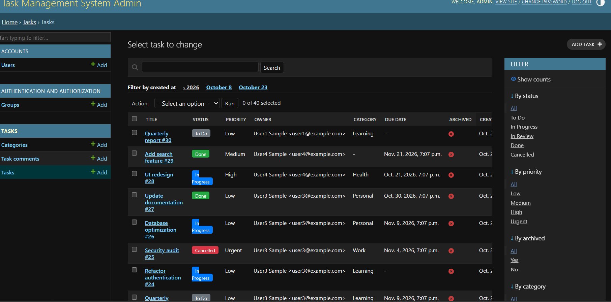

# Task Management System

A production-ready **RESTful API** built with **Django 6.1** and **Django REST Framework** for managing tasks, categories, and user accounts. Features JWT authentication, filtering, searching, pagination, and a customized Django Admin interface.

---

## Table of Contents
## Screenshots

### Login (JWT)


### Tasks list


### Filtering


- [Features](#features)
- [Tech Stack](#tech-stack)
- [Project Structure](#project-structure)
- [Installation](#installation)
- [Configuration](#configuration)
- [Running the Server](#running-the-server)
- [API Documentation](#api-documentation)
- [API Examples](#api-examples)
- [Running Tests](#running-tests)
  ''' bash python manage.py test'''
- [Admin Interface](#admin-interface)

---

## Features

- **RESTful CRUD API** for Tasks and Categories
- **JWT Authentication** (access + refresh tokens)
- **Custom User Model** (email as login, bio, avatar)
- **Task Features**: status, priority, due dates, tags, archiving, comments
- **Advanced Filtering**: by status, priority, category, date ranges
- **Full-text Search**: across title, description, and tags
- **Pagination**: configurable page size
- **Role-based Permissions**: owners can only access their own tasks
- **Extra Endpoints**: complete, reopen, archive, stats, overdue
- **Customized Django Admin**: color badges, search, filters
- **Seed Command**: populate DB with sample data

---

## Tech Stack

| Component        | Technology                          |
|-----------------|--------------------------------------|
| Framework        | Django 6.1.2                        |
| REST API         | Django REST Framework 3.18.3        |
| Authentication   | djangorestframework-simplejwt 5.5.1 |
| CORS             | django-cors-headers 4.9.0           |
| Filtering        | django-filter 26.2                  |
| Database         | SQLite (dev) / PostgreSQL (prod)    |
| Configuration    | python-decouple 3.8                 |
| Image Handling   | Pillow                       |

---

## Project Structure

```
task-management-system/
├── config/                    # Django project settings
│   ├── __init__.py
│   ├── settings.py            # Main settings (env-based)
│   ├── urls.py                # Root URL configuration
│   ├── wsgi.py
│   └── asgi.py
│
├── accounts/                  # User management app
│   ├── migrations/
│   ├── admin.py               # Custom user admin
│   ├── apps.py
│   ├── models.py              # Custom User model
│   ├── serializers.py         # User serializers
│   ├── urls.py                # Auth endpoints
│   └── views.py               # Registration, profile views
│
├── tasks/                     # Core tasks app
│   ├── management/
│   │   └── commands/
│   │       └── seed_data.py   # DB seeder command
│   ├── migrations/
│   ├── admin.py               # Task/Category admin
│   ├── apps.py
│   ├── filters.py             # FilterSet for tasks
│   ├── models.py              # Task, Category, Comment models
│   ├── permissions.py         # Custom DRF permissions
│   ├── serializers.py         # Task/Category serializers
│   ├── urls.py                # Task API router
│   └── views.py               # Task/Category ViewSets
│
├── tests.py                   # API test suite
├── manage.py
├── requirements.txt
├── .env.example
├── .gitignore
└── README.md
```

---

## Installation

### Prerequisites

- Python 3.10+
- pip
- Git

### Step-by-Step Setup

```bash
# 1. Clone the repository
git clone https://github.com/aldhyanifaris-cell/task-management-system.git
cd task-management-system

# 2. Create virtual environment
python -m venv venv

# 3. Activate virtual environment
# Windows:
venv\Scripts\activate
# macOS/Linux:
source venv/bin/activate

# 4. Install dependencies
pip install -r requirements.txt

# 5. Set up environment variables
cp .env.example .env
copy .env.example .env
# Edit .env with your values

# 6. Run database migrations
python manage.py migrate

# 7. Create a superuser
python manage.py createsuperuser

# 8. (Optional) Seed with sample data
python manage.py seed_data --users 5 --tasks 30

# 9. Run the development server
python manage.py runserver
```

The API will be available at: **http://127.0.0.1:8000**

---

## Configuration

Copy `.env.example` to `.env` and configure:

```env
SECRET_KEY=your-secret-key-here
DEBUG=True
ALLOWED_HOSTS=localhost,127.0.0.1
DB_NAME=db.sqlite3
JWT_ACCESS_LIFETIME=60
JWT_REFRESH_LIFETIME=7
CORS_ALLOWED_ORIGINS=http://localhost:3000
```

---

## Running the Server

```bash
# Development server
python manage.py runserver

# Custom port
python manage.py runserver 0.0.0.0:8080
```

---

## API Documentation

### Base URL
```
http://localhost:8000/api/v1/
```

### Authentication Endpoints

| Method | Endpoint                    | Description              | Auth Required |
|--------|-----------------------------|--------------------------|---------------|
| POST   | `/auth/login/`              | Login (get JWT tokens)   | No            |
| POST   | `/auth/refresh/`            | Refresh access token     | No            |
| POST   | `/auth/verify/`             | Verify token             | No            |
| POST   | `/auth/register/`           | Register new user        | No            |
| GET    | `/auth/profile/`            | Get current user profile | Yes           |
| PATCH  | `/auth/profile/`            | Update user profile      | Yes           |
| PUT    | `/auth/change-password/`    | Change password          | Yes           |
| DELETE | `/auth/delete-account/`     | Delete account           | Yes           |

### Task Endpoints

| Method | Endpoint                        | Description                  | Auth Required |
|--------|---------------------------------|------------------------------|---------------|
| GET    | `/tasks/`                       | List user tasks (paginated)  | Yes           |
| POST   | `/tasks/`                       | Create a new task            | Yes           |
| GET    | `/tasks/{id}/`                  | Retrieve task detail         | Yes           |
| PUT    | `/tasks/{id}/`                  | Update task (full)           | Yes           |
| PATCH  | `/tasks/{id}/`                  | Update task (partial)        | Yes           |
| DELETE | `/tasks/{id}/`                  | Delete task                  | Yes           |
| POST   | `/tasks/{id}/complete/`         | Mark task as done            | Yes           |
| POST   | `/tasks/{id}/reopen/`           | Reopen task                  | Yes           |
| POST   | `/tasks/{id}/archive/`          | Toggle archive               | Yes           |
| GET    | `/tasks/{id}/comments/`         | List task comments           | Yes           |
| POST   | `/tasks/{id}/add-comment/`      | Add a comment                | Yes           |
| GET    | `/tasks/my-tasks/`              | My tasks only                | Yes           |
| GET    | `/tasks/overdue/`               | Overdue tasks                | Yes           |
| GET    | `/tasks/stats/`                 | Task statistics              | Yes           |

### Category Endpoints

| Method | Endpoint              | Description              | Auth Required |
|--------|-----------------------|--------------------------|---------------|
| GET    | `/categories/`        | List all categories      | No            |
| POST   | `/categories/`        | Create category          | Yes           |
| GET    | `/categories/{id}/`   | Retrieve category        | No            |
| PUT    | `/categories/{id}/`   | Update category          | Yes (owner)   |
| PATCH  | `/categories/{id}/`   | Partial update           | Yes (owner)   |
| DELETE | `/categories/{id}/`   | Delete category          | Yes (owner)   |

### Query Parameters

#### Tasks Filtering
| Parameter       | Type     | Description                            |
|-----------------|----------|----------------------------------------|
| `status`        | string   | todo, in_progress, review, done, cancelled |
| `priority`      | string   | low, medium, high, urgent              |
| `category`      | integer  | Category ID                            |
| `category_name` | string   | Category name (partial match)          |
| `is_archived`   | boolean  | true or false                          |
| `due_date_before` | datetime | ISO 8601 format                      |
| `due_date_after` | datetime | ISO 8601 format                       |
| `created_before` | datetime | ISO 8601 format                       |
| `created_after` | datetime | ISO 8601 format                        |
| `has_due_date`  | boolean  | Filter tasks with/without due date     |
| `tags`          | string   | Tag search (partial match)             |
| `search`        | string   | Full-text search (title, description, tags) |
| `ordering`      | string   | Sort by: created_at, due_date, priority, status |
| `page`          | integer  | Page number                            |
| `page_size`     | integer  | Results per page (default: 10)         |

---

## API Examples

### 1. Register & Login

```bash
# Register a new user
curl -X POST http://localhost:8000/api/v1/auth/register/ \
  -H "Content-Type: application/json" \
  -d '{
    "username": "johndoe",
    "email": "john@example.com",
    "first_name": "John",
    "last_name": "Doe",
    "password": "SecurePass123!",
    "password_confirm": "SecurePass123!"
  }'

# Login to get tokens
curl -X POST http://localhost:8000/api/v1/auth/login/ \
  -H "Content-Type: application/json" \
  -d '{"email": "john@example.com", "password": "SecurePass123!"}'
```

**Response:**
```json
{
  "access": "eyJ0eXAiOiJKV1Qi...",
  "refresh": "eyJ0eXAiOiJKV1Qi..."
}
```

### 2. Create a Task

```bash
curl -X POST http://localhost:8000/api/v1/tasks/ \
  -H "Authorization: Bearer <access_token>" \
  -H "Content-Type: application/json" \
  -d '{
    "title": "Build REST API",
    "description": "Create a Django REST API for task management",
    "status": "in_progress",
    "priority": "high",
    "category_id": 1,
    "due_date": "2026-12-31T23:59:00Z",
    "tags": "backend,django,api"
  }'
```

### 3. Filter Tasks

```bash
# Get high priority, in-progress tasks due before Dec 2026
curl "http://localhost:8000/api/v1/tasks/?status=in_progress&priority=high&due_date_before=2026-12-31" \
  -H "Authorization: Bearer <access_token>"

# Search tasks by keyword
curl "http://localhost:8000/api/v1/tasks/?search=django&ordering=-created_at" \
  -H "Authorization: Bearer <access_token>"
```

### 4. Task Statistics

```bash
curl http://localhost:8000/api/v1/tasks/stats/ \
  -H "Authorization: Bearer <access_token>"
```

**Response:**
```json
{
  "total": 25,
  "by_status": {
    "todo": 8,
    "in_progress": 10,
    "review": 3,
    "done": 4,
    "cancelled": 0
  },
  "by_priority": {
    "low": 5,
    "medium": 12,
    "high": 7,
    "urgent": 1
  },
  "overdue": 3,
  "completed_today": 1,
  "archived": 2
}
```

### 5. Complete a Task

```bash
curl -X POST http://localhost:8000/api/v1/tasks/1/complete/ \
  -H "Authorization: Bearer <access_token>"
```

---

## Running Tests

```bash
# Run all tests
python manage.py test tests

# Run with verbosity
python manage.py test tests --verbosity=2

# Using pytest (if installed)
pytest tests.py -v
```

---

## Admin Interface

Access the Django Admin at: **http://localhost:8000/admin/**

Login with your superuser credentials. The admin provides:
- **User Management**: view/edit users, verify accounts
- **Task Management**: color-coded status badges, inline comments
- **Category Management**: color swatches, task counts
- **Full Search & Filtering** on all models

---

## Development Commands

```bash
# Seed sample data
> ⚠️ The seed command creates demo users with a known password. For local development only; never run it in production.
python manage.py seed_data --users 5 --tasks 30

# Clear and reseed
python manage.py seed_data --clear --users 3 --tasks 20

# Create migrations
python manage.py makemigrations

# Apply migrations
python manage.py migrate

# Collect static files
python manage.py collectstatic

```
Tested with Python 3.15
---

## License

MIT License - See [LICENSE](LICENSE) for details.

## Author

Faris Al-Dhyani — [GitHub](https://github.com/aldhyanifaris-cell)